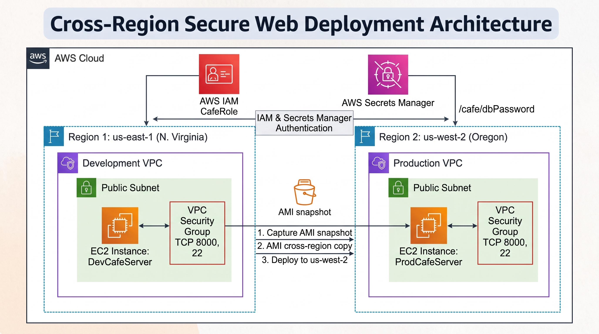
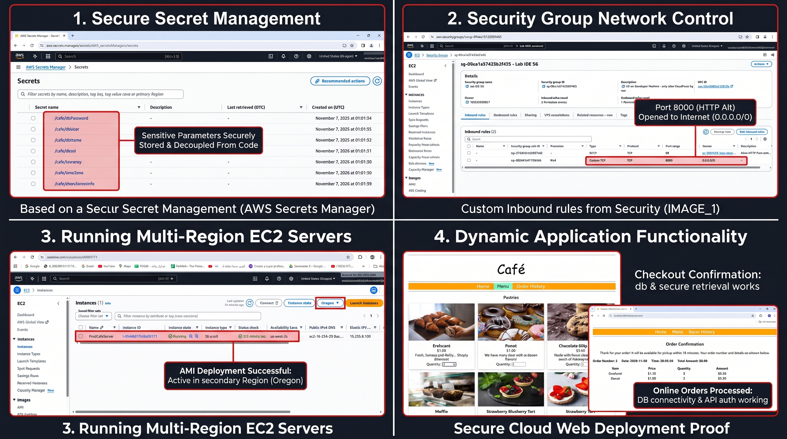

# ☁️ Cross-Region Secure Web Deployment on AWS

## 📌 Project Overview

This project demonstrates the deployment of a dynamic café web application on Amazon Web Services (AWS), using two separate AWS Regions to establish development and production environments.

The application enables customers to browse products, submit online orders, and view order history through a PHP-based web application connected to a MariaDB database.

The infrastructure uses AWS security and deployment services to manage application permissions, sensitive configuration parameters, network access, and cross-region deployment.

## 🎯 Business Scenario

The café initially operated a static website that did not support online ordering.

The business required a dynamic web application with the following capabilities:

- Online ordering functionality.
- Database integration for storing application data and orders.
- Secure management of database credentials.
- Separate development and production environments.
- Cross-region deployment to establish a foundation for disaster recovery.

## 🏗️ Architecture Diagram

The following diagram illustrates the AWS infrastructure and the relationship between the two environments.

### AWS Regions

| Region | Environment | EC2 Instance |
|---|---|---|
| us-east-1 (N. Virginia) | Development | DevCafeServer |
| us-west-2 (Oregon) | Production | ProdCafeServer |

## 🛠️ AWS Services & Technologies

| Service / Technology | Purpose |
|---|---|
| Amazon EC2 | Hosts the dynamic web application |
| AWS IAM | Manages application permissions through IAM roles |
| AWS Secrets Manager | Securely stores application parameters and database credentials |
| Amazon Machine Image (AMI) | Creates reusable EC2 server images |
| Amazon VPC | Provides isolated network environments |
| Security Groups | Controls inbound and outbound network traffic |
| Apache HTTP Server | Handles incoming HTTP requests |
| PHP | Executes server-side application logic |
| MariaDB | Stores application data and customer orders |
| Linux / Bash | Server administration and automation |
| AWS CLI | Automates AWS resource configuration |

## ⚙️ Implementation Steps

### 1. EC2 Environment Configuration

- Connected to the existing EC2-based VS Code IDE.
- Inspected the Amazon Linux operating system.
- Configured Apache to listen on TCP port 8000.
- Started and enabled the Apache service.
- Installed and configured MariaDB.
- Prepared the Apache web root directory for application deployment.
- Verified external web server accessibility.

### 2. Dynamic Web Application Deployment

- Downloaded and extracted the café application files.
- Deployed the PHP application under the Apache document root.
- Installed the AWS SDK for PHP.
- Configured the MariaDB database.
- Created the required database tables and application data.
- Tested database connectivity and application functionality.

### 3. Secure Secret Management

Used AWS Secrets Manager to store sensitive application configuration parameters.

Implementation included:

- Creating application secrets using an AWS CLI shell script.
- Configuring the CafeRole IAM instance role.
- Allowing the EC2 application to retrieve authorized secrets.
- Using the AWS SDK for PHP to retrieve configuration values.
- Avoiding hardcoded AWS credentials and database passwords in application source code.

### 4. Network Security Configuration

Configured EC2 Security Groups to control application and administrative access.

- TCP 8000: Application HTTP access.
- TCP 22: SSH administrative access.

Inbound rules were configured to allow the required connectivity for the lab environment.

### 5. Cross-Region Deployment

Created a separate production environment using the existing development server configuration.

Deployment workflow:

1. Prepared the development EC2 instance.
2. Generated an Amazon Machine Image (AMI).
3. Copied the AMI from us-east-1 to us-west-2.
4. Launched a new EC2 instance named ProdCafeServer.
5. Configured the destination network and Security Group.
6. Attached the CafeRole IAM instance profile.
7. Created the required application secrets in the destination Region.
8. Verified the production application.

## 🧪 Testing & Validation

The application and infrastructure were tested through the following scenarios:

- Verified Apache service status.
- Confirmed web server accessibility through TCP port 8000.
- Verified the café website loaded successfully.
- Confirmed that product listings were displayed.
- Submitted online customer orders.
- Verified order confirmation functionality.
- Checked order history and database connectivity.
- Validated the production deployment in us-west-2.

## 📸 Project Evidence

The following screenshots demonstrate the implemented infrastructure and application functionality.

### Implementation Results

The evidence includes:

1. AWS Secrets Manager – Secure application parameter storage.
2. EC2 Security Groups – Custom inbound network rules.
3. Multi-Region EC2 Deployment – Production instance running in Oregon.
4. Dynamic Café Application – Online ordering and checkout confirmation.

## 🔐 Security Considerations

Security measures implemented in this project include:

- IAM instance roles for controlled access to AWS services.
- AWS Secrets Manager for sensitive configuration storage.
- Security Groups for network traffic control.
- Separation of development and production environments.

**Production security improvements:**

- Restrict SSH access to trusted IP addresses.
- Use HTTPS instead of exposing the application through plain HTTP.
- Place application instances in private subnets behind an Application Load Balancer.
- Restrict database network access.
- Implement secret rotation and appropriate IAM least-privilege policies.

## ⚠️ Challenges & Troubleshooting

| Challenge | Solution |
|---|---|
| Web server accessibility | Configured Apache and Security Group rules |
| Database installation and connectivity | Installed and configured MariaDB |
| Application configuration retrieval | Configured IAM permissions and Secrets Manager access |
| Cross-region application deployment | Created and copied an AMI between AWS Regions |
| Production application verification | Configured destination-region secrets and validated application functionality |

## 🚀 Future Improvements

The following improvements could extend this project into a more production-oriented architecture:

- Amazon RDS for managed database hosting.
- Application Load Balancer for traffic distribution.
- Private subnets for application and database resources.
- AWS Certificate Manager for HTTPS.
- Terraform for Infrastructure as Code.
- GitHub Actions for CI/CD automation.
- Amazon CloudWatch for monitoring and alerting.
- Cross-region database backups and disaster recovery.
- Route 53 for DNS management and failover routing.

## 📚 Skills Demonstrated

`Amazon EC2` `AWS IAM` `AWS Secrets Manager` `AMI` `VPC` `Security Groups` `Linux` `Bash` `AWS CLI` `Apache` `PHP` `MariaDB` `SQL` `Cross-Region Deployment` `Troubleshooting`

## 📌 Project Scope & Limitations

This project was implemented as a hands-on educational AWS lab.

The cross-region deployment demonstrates the creation of separate development and production environments using AMI copying.

It does not implement automatic traffic failover, live database replication, a multi-AZ highly available architecture, or a complete production disaster recovery solution.

The initial Lab IDE infrastructure was provided by the training environment.

## 👨‍💻 Author

**Omar Metawea**

Cloud Computing | AWS | Linux | Infrastructure & Deployment

